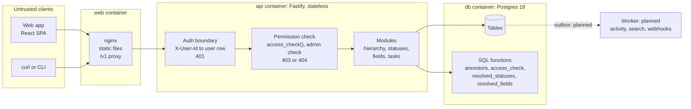
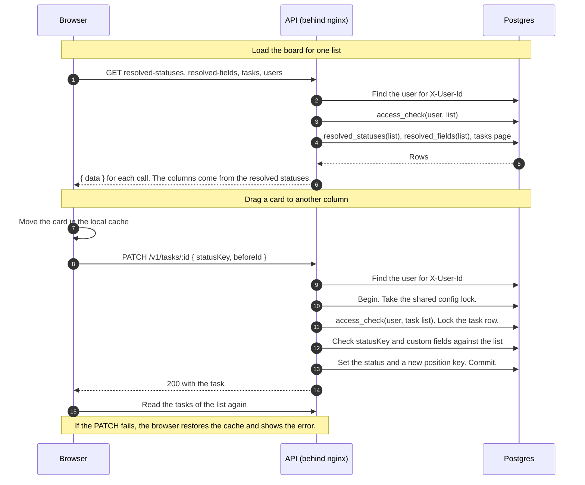
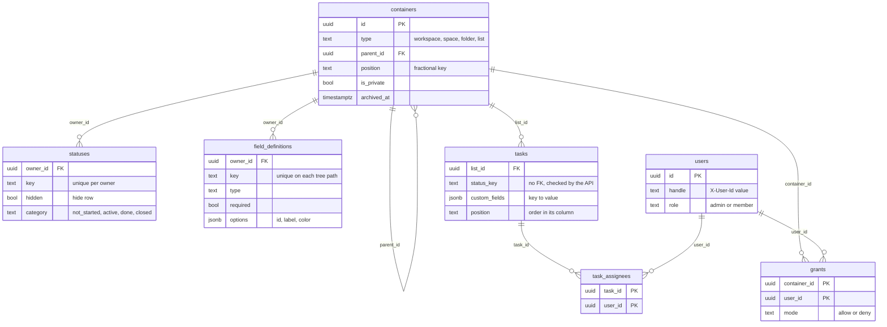

# Flowboard

Flowboard is a small project-management app for one team. Work sits in a tree of containers: workspace, space, folder and list. Each container can change the statuses and the custom fields of the lists below it.

| Spec §9 item             | Section                                                      |
| ------------------------ | ------------------------------------------------------------ |
| 1. One-command run       | [1. Run](#1-run)                                             |
| 2. System design diagram | [2. System design](#2-system-design)                         |
| 3. Data model            | [3. Data model](#3-data-model)                               |
| 4. API overview          | [4. API](#4-api)                                             |
| 5. Auth and channels     | [5. Auth and channels](#5-auth-and-channels)                 |
| 6. Scalability and IPC   | [6. Scalability and IPC](#6-scalability-and-ipc)             |
| 7. Trade-offs            | [7. Trade-offs and next steps](#7-trade-offs-and-next-steps) |
| 8. AI usage              | [8. AI usage](#8-ai-usage)                                   |
| §8 Tests                 | [Tests](#tests)                                              |

Other documents: [`docs/PLAN.md`](docs/PLAN.md) (build plan and decisions), [`docs/DESIGN.md`](docs/DESIGN.md) (UI design), [`AI_USAGE.md`](AI_USAGE.md).

## 1. Run

Prerequisite: Docker with Compose v2.

```bash
docker compose up --build      # or: make up
```

On first boot, the API applies the migrations and then adds the demo data. Both steps are idempotent, so a restart keeps your data. To start again from the demo data, run `make reset` and then `make up`.

| Service | URL                   | Notes                                                 |
| ------- | --------------------- | ----------------------------------------------------- |
| web     | http://localhost:8080 | React app. nginx sends `/v1` to the API.              |
| api     | http://localhost:3000 | Fastify, REST under `/v1`                             |
| db      | localhost:5432        | Postgres 18. User, password and database: `flowboard` |

To change ports or credentials, copy `.env.example` to `.env`. The stack also starts without a `.env` file.

### Demo users

Every `/v1` request needs the `X-User-Id` header. The only exception is `/v1/health`. In the web app, select the user at the top of the sidebar.

| `X-User-Id` | Role   | Grants in the demo data                 | Sees                              |
| ----------- | ------ | --------------------------------------- | --------------------------------- |
| `alice`     | admin  | none (an admin sees all)                | all containers                    |
| `bob`       | member | deny on the list "Sprint"               | Engineering › Q2 Launch › Backlog |
| `carol`     | member | allow on the private space "Leadership" | all containers                    |

```bash
curl -s localhost:8080/v1/tree -H 'X-User-Id: bob'
```

## 2. System design

Flowboard is one API process (a modular monolith) and one Postgres database. nginx serves the web app and sends `/v1` requests to the API. There is no worker yet: section 6 gives the plan.



### Trust boundaries

- The API trusts no value from a client. For each request, it reads the role and the grants from Postgres.
- nginx adds no security. It only serves files and forwards `/v1`.
- The web app hides admin buttons from members. This is for convenience only. The API enforces every rule.

### Where each check runs

| Check         | Where                                                                | Result when it fails                             |
| ------------- | -------------------------------------------------------------------- | ------------------------------------------------ |
| Identity      | `onRequest` hook, for every `/v1` request except health              | 401                                              |
| Visibility    | `access_check()` before each read or write of a container or task    | 403. 404 if the container is absent or archived. |
| Tree filter   | The recursive query of `GET /v1/tree` stops at each hidden container | The container is not in the response             |
| Config change | Admin check in each status, field, container and grant route         | 403                                              |
| Data rules    | Body schemas, the custom-field validator and Postgres constraints    | 400 or 409                                       |

### Where status and field resolution lives

Status and field definitions attach to containers. They do not attach to lists only. Postgres functions compute the resolved set when a client asks for it. The API copies nothing down the tree, so a change on a space reaches every list below it at once. Section 3 gives the rules.

### Request flow: load the board, then drag a card



## 3. Data model

The model has 4 parts:

1. A tree of containers.
2. Statuses and fields that attach to containers.
3. Tasks that live in lists.
4. Grants that control access.



The SQL is in `apps/api/migrations/`. Each file adds one part, in build order.

### 3.1 Container tree

- One table holds all 4 levels. A row points to its parent (an adjacency list).
- Postgres enforces one rule: only a workspace has no parent. The API enforces the parent type: a folder must be in a space.
- A text key sets the order of siblings. A reorder changes one row only.
- To delete a container, the API archives it. Its descendants stay, and the access check hides them through the archived ancestor.

### 3.2 Status inheritance

Statuses use **merge by key**. Each level can add a key, override an inherited key, or hide it. To resolve the statuses of a list, `resolved_statuses()` does these steps:

1. Collect the status rows of the list and of each ancestor.
2. For each key, keep the row from the nearest level.
3. Remove the keys whose nearest row is a hide row.
4. Sort the rows that stay by position.

The order of steps 2 and 3 is important. If the function removed hide rows first, the parent row would win, and the hide would have no effect.

| Level in the demo data | Change                       | Backlog (list A)            | Sprint (list B)                                 |
| ---------------------- | ---------------------------- | --------------------------- | ----------------------------------------------- |
| Workspace              | To do, In progress, Done     |                             |                                                 |
| Space Engineering      | Add "In review"              |                             |                                                 |
| Folder Q2 Launch       | Override "done" as "Shipped" |                             |                                                 |
| List                   |                              | Hide "In review"            | Add "Blocked"                                   |
| **Board columns**      |                              | To do, In progress, Shipped | To do, In progress, In review, Blocked, Shipped |

Two more rules apply:

- **Each resolved set needs a `not_started`, an `active` and a `done` status.** A status change runs in one transaction. Then it checks each container below the changed level. If a set breaks, the change rolls back with 400 `STATUS_SET_INCOMPLETE`.
- **A task stores the status key, not the status id.** An override on a lower level is a new row with a new id. The key stays the same at each level, so it is the stable identity.

### 3.3 Custom-field resolution

The field schema of a list is the union of the active definitions on the list and its ancestors.

- **Key collisions are explicit.** A key must be unique on each path from the workspace to a list. The API checks up and down the tree and returns 409 `FIELD_KEY_COLLISION`.
- **Values live in `tasks.custom_fields` (jsonb).** A select value stores the option id, not the label. An admin can rename a label, and no task changes.
- **The API checks every value** against the resolved schema of the task's list. It returns all problems in one 400, with paths such as `customFields.estimate`.

| Type            | Valid value                                                           |
| --------------- | --------------------------------------------------------------------- |
| `text`          | String, 5,000 characters maximum                                      |
| `number`        | Finite number. The string `"5"` is not valid.                         |
| `date`          | Real calendar date as `YYYY-MM-DD`                                    |
| `checkbox`      | `true` or `false`                                                     |
| `single_select` | One option id                                                         |
| `multi_select`  | Array of option ids, no duplicates                                    |
| Any type        | `null` clears the value. The API refuses `null` for a required field. |

### 3.4 Policies for the hard cases

| Case                                                            | Policy                                                                                                                                                              |
| --------------------------------------------------------------- | ------------------------------------------------------------------------------------------------------------------------------------------------------------------- |
| A task moves to a list without its status                       | The API keeps the key if the destination has it. If not, the body must name a `statusKey`. Without it, the API returns 400.                                         |
| A task moves to a list without some of its fields               | The API removes those values. The response names them in `strippedFields`.                                                                                          |
| The destination requires a field that the task has no value for | The API returns 400. The client sends the value in the move body.                                                                                                   |
| An admin deletes or hides a status that tasks use               | The API returns 409 `STATUS_IN_USE`. With `?remapTo=<key>`, the API moves the tasks first and then removes the status.                                              |
| An admin changes a field definition that tasks use              | A type change returns 409 `FIELD_TYPE_LOCKED`. The removal of an option in use returns 409 `OPTION_IN_USE`. A field delete archives the field, and the values stay. |

The test `config safety` asserts that `orphan_tasks()` returns 0 rows after each of these changes.

## 4. API

The API is REST over JSON. All routes are under `/v1`. Property names use camelCase.

| Topic      | Rule                                                                                                                               |
| ---------- | ---------------------------------------------------------------------------------------------------------------------------------- |
| URLs       | Plural nouns. An action that is not a plain update is a `POST` to a sub-path, for example `/move`.                                 |
| Verbs      | `GET` reads. `POST` creates or runs an action. `PATCH` changes some properties. `PUT` sets a value (idempotent). `DELETE` removes. |
| Responses  | One resource: the object. A collection: `{ data }`. Tasks: `{ data, nextCursor }`.                                                 |
| Errors     | `{ error: { code, message, details? } }`. A 400 lists every problem as `{ path, issue }`.                                          |
| Validation | Unknown properties return 400. Body types are strict. Query values change to their schema type.                                    |
| Pagination | Keyset cursor on the task collection: `limit` 1–200 (default 50), `cursor`, `sort`, `order`.                                       |
| Versioning | A new property stays in `/v1`. A breaking change gets `/v2`, and `/v1` stays for clients that still use it.                        |

### Routes

Each row maps to one route in `apps/api/src/modules/*/routes.ts`. "Admin" means that a member gets 403.

| Method | Path                                              | Who    | Notes                                                                     |
| ------ | ------------------------------------------------- | ------ | ------------------------------------------------------------------------- |
| GET    | `/v1/health`                                      | anyone | No identity needed                                                        |
| GET    | `/v1/me`, `/v1/users`                             | user   | The caller, and all users for the assignee picker                         |
| GET    | `/v1/tree`                                        | user   | Visible containers only, parents before children                          |
| GET    | `/v1/containers/:id`                              | user   |                                                                           |
| POST   | `/v1/containers`                                  | admin  | `{ parentId, type, name, isPrivate?, afterId?, beforeId? }`               |
| PATCH  | `/v1/containers/:id`                              | admin  | `name`, `isPrivate`                                                       |
| POST   | `/v1/containers/:id/move`                         | admin  | New parent or new place among siblings                                    |
| POST   | `/v1/containers/:id/archive`, `/unarchive`        | admin  | Soft delete and restore                                                   |
| GET    | `/v1/containers/:id/grants`                       | admin  |                                                                           |
| PUT    | `/v1/containers/:id/grants/:userId`               | admin  | `{ mode: "allow" \| "deny" }`                                             |
| DELETE | `/v1/containers/:id/grants/:userId`               | admin  |                                                                           |
| GET    | `/v1/containers/:id/resolved-statuses`            | user   | Board columns. Works on any container.                                    |
| GET    | `/v1/containers/:id/statuses`                     | user   | Rows on this level only                                                   |
| POST   | `/v1/containers/:id/statuses`                     | admin  | Add, override, or hide with `{ key, hidden: true }`. Accepts `?remapTo=`. |
| PATCH  | `/v1/statuses/:id`                                | admin  | Name, category, colour, place                                             |
| DELETE | `/v1/statuses/:id`                                | admin  | Accepts `?remapTo=`                                                       |
| GET    | `/v1/containers/:id/resolved-fields`              | user   | Field schema for a task form                                              |
| GET    | `/v1/containers/:id/fields`                       | user   | Definitions on this level, archived ones too                              |
| POST   | `/v1/containers/:id/fields`                       | admin  |                                                                           |
| PATCH  | `/v1/fields/:id`                                  | admin  | Name, required, options, place                                            |
| DELETE | `/v1/fields/:id`, POST `/v1/fields/:id/unarchive` | admin  | Archive and restore                                                       |
| GET    | `/v1/lists/:id/tasks`                             | user   | `?limit&cursor&sort&order&statusKey&fieldKey&fieldValue`                  |
| POST   | `/v1/lists/:id/tasks`                             | user   | Create                                                                    |
| GET    | `/v1/tasks/:id`                                   | user   |                                                                           |
| PATCH  | `/v1/tasks/:id`                                   | user   | Also the board actions: `statusKey`, `afterId`, `beforeId`                |
| POST   | `/v1/tasks/:id/move`                              | user   | Move to another list. The caller needs access to both lists.              |
| DELETE | `/v1/tasks/:id`                                   | user   | Hard delete                                                               |

### Error codes

| HTTP | `code`                                                                                            | Cause                                          |
| ---- | ------------------------------------------------------------------------------------------------- | ---------------------------------------------- |
| 400  | `VALIDATION_FAILED`                                                                               | Body, query, status key or custom-field values |
| 400  | `STATUS_SET_INCOMPLETE`                                                                           | A status change breaks a resolved set          |
| 401  | `UNAUTHENTICATED`                                                                                 | No `X-User-Id`, or an unknown user             |
| 403  | `FORBIDDEN`                                                                                       | No access, or a member calls an admin route    |
| 404  | `NOT_FOUND`                                                                                       | The resource is absent or archived             |
| 409  | `STATUS_IN_USE`, `OPTION_IN_USE`, `FIELD_TYPE_LOCKED`, `FIELD_KEY_COLLISION`, `STATUS_KEY_EXISTS` | A config change conflicts with data            |
| 409  | `CONFLICT`                                                                                        | Two writes collided. Send the request again.   |

## 5. Auth and channels

### 5.1 Mock identity

1. The client sends `X-User-Id` with a handle: `alice`, `bob` or `carol`.
2. The `onRequest` hook finds that user in Postgres. If the header is absent or unknown, the API returns 401.
3. The hook attaches the user row to the request. The role comes from that row only.
4. Each route then checks access to its container (section 2).

> **WARNING: DO NOT EXPOSE THIS STACK ON A NETWORK.** Any client can send any `X-User-Id`. The mock identity proves the auth boundary. It is not a login.

### 5.2 Change to OIDC for production

Only the `onRequest` hook changes. The permission checks and the routes stay the same.

1. Configure an identity provider, for example Auth0, Okta or Keycloak.
2. In the hook, verify the token signature, issuer, audience and expiry. Use the provider's public keys (JWKS).
3. Find the user by the token's `sub` claim. Create the user row on the first login.
4. In the web app, use a backend-for-frontend with an `httpOnly` session cookie. Then the browser never holds the token.

### 5.3 Channels

All channels use the same REST contract, the same auth header and the same error shape.

| Channel       | Status | Notes                                                                               |
| ------------- | ------ | ----------------------------------------------------------------------------------- |
| Web app       | Built  | The primary channel                                                                 |
| curl or CLI   | Built  | The examples in this README. The API needs no browser state.                        |
| Mobile client | Design | A board needs 4 requests now. A mobile backend-for-frontend can join them into one. |
| Webhooks      | Design | The `task.updated` event in section 6.4 is the payload.                             |

| Shared by all channels                   | Web app only                                                                                                     |
| ---------------------------------------- | ---------------------------------------------------------------------------------------------------------------- |
| Routes, request schemas, error codes     | The user switcher (it replaces a login screen)                                                                   |
| Auth header and permission rules         | The optimistic board update and its rollback                                                                     |
| Validation of statuses and custom fields | The sort and filter of the table view in the browser. The API offers the same sort and filter for other clients. |

## 6. Scalability and IPC

**Built:** one stateless API process and one Postgres database. **Not built:** a worker, a queue or a second service. This is the "single service with a documented IPC plan" option of the spec.

### 6.1 Module boundaries

| Module      | Owns these tables         | Other modules call                           |
| ----------- | ------------------------- | -------------------------------------------- |
| identity    | `users`                   | `request.user`                               |
| permissions | `grants`                  | `requireAccess()`, `requireAdmin()`          |
| hierarchy   | `containers`              | `ancestors()` (SQL)                          |
| statuses    | `statuses`                | `resolvedStatuses()`                         |
| fields      | `field_definitions`       | `resolvedFields()`, `validateCustomFields()` |
| tasks       | `tasks`, `task_assignees` | none                                         |

There are two exceptions to these boundaries. The in-use checks for statuses and options read `tasks` directly. A split would change them into calls to the task service.

### 6.2 Horizontal scale

- The API keeps no state in memory. Any replica can serve any request.
- To scale out, run more API replicas behind nginx (an `upstream` block).
- Migrations and the demo data run under one Postgres advisory lock. Two replicas can boot at the same time.
- Each process has a pool of 10 connections. With many replicas, add PgBouncer in front of Postgres.
- For more read load, send the tree and board reads to a read replica.

### 6.3 Index notes

| Load                         | Query                                          | Index                                                              |
| ---------------------------- | ---------------------------------------------- | ------------------------------------------------------------------ |
| Tree                         | Walk down by `parent_id`                       | `containers_sibling_order (parent_id, position)`, active rows only |
| Access check and resolution  | Walk up by `id`, 4 levels maximum              | Primary key                                                        |
| Board                        | Tasks of one list, by status and position      | `tasks_board (list_id, status_key, position)`                      |
| In-use status check          | Tasks with one status key                      | `tasks_status_key`                                                 |
| Custom-field filter          | `custom_fields -> key` on the rows of one list | `tasks_board` finds the list. There is no jsonb index yet.         |
| Sort by due date or priority | Expression sort on the rows of one list        | None yet                                                           |

When lists grow to thousands of tasks, add these indexes:

1. A GIN index on `custom_fields` (`jsonb_path_ops`) for filters with `@>`.
2. An expression index for each custom field that users filter often.
3. An index on `(list_id, due_date)` for the due-date sort.

### 6.4 Plan for weeks 2 to 4

Keep the core together: hierarchy, statuses, fields, tasks and permissions. One transaction validates a task against the statuses, the fields and the grants. A split would need a distributed transaction for each task write.

Split the slow side effects:

| New service     | Why a separate process                                     |
| --------------- | ---------------------------------------------------------- |
| Activity worker | "Alice moved X to Done" must not slow down the task write. |
| Search indexer  | Full-text search across lists needs its own index.         |
| Webhook sender  | External endpoints fail and need retries.                  |
| Identity        | Move to an external identity provider (section 5.2).       |

The async path is a **transactional outbox** in Postgres. It needs no new infrastructure.

1. A task write inserts an event row into `outbox`, in the same transaction.
2. The worker claims rows with `select ... for update skip locked`.
3. The worker sends each event to its consumers.
4. If a consumer fails, the worker tries again with a longer wait each time. After 8 tries, it moves the event to a dead-letter table.

```json
{
  "id": "evt_01JD9Q7Z3K",
  "type": "task.updated",
  "occurredAt": "2026-11-13T10:42:07Z",
  "actorId": "c1b2…",
  "data": {
    "taskId": "8e72…",
    "listId": "8f38…",
    "version": 14,
    "changes": { "statusKey": { "from": "in_progress", "to": "in_review" } }
  }
}
```

| Failure mode               | Rule                                                                                                              |
| -------------------------- | ----------------------------------------------------------------------------------------------------------------- |
| An event arrives twice     | Delivery is at least once. Each consumer keeps the event ids that it has applied, and it ignores a repeat.        |
| Events arrive out of order | Each task has a `version` that increases by one for each change. A consumer ignores an older version.             |
| A read shows old data      | The activity feed and search can be some seconds old. The board reads Postgres directly, so it is always current. |

## 7. Trade-offs and next steps

| Decision                                         | Gain                                                          | Cost                                                                         |
| ------------------------------------------------ | ------------------------------------------------------------- | ---------------------------------------------------------------------------- |
| One `containers` table for all levels            | One foreign key for statuses, fields and grants               | The API, not Postgres, checks the parent type                                |
| Tasks store `status_key`, not a status id        | Overrides do not break tasks                                  | No foreign key. Tests and `orphan_tasks()` guard the rule.                   |
| Custom values in jsonb                           | One read per task. The shape changes for each list.           | Postgres cannot check types. The API validator must be complete.             |
| Resolution in SQL functions                      | One source of truth for the API, the validators and the tests | Logic in SQL is harder to debug than TypeScript                              |
| A move removes values that the destination lacks | The task always matches its list                              | Data loss. The UI shows the values before the move.                          |
| One workspace lock for config writes             | Two admins cannot break a status set together                 | Config writes run one at a time. Task writes wait for a config write to end. |
| 403 for a hidden container, as the spec asks     | Clear errors in the demo                                      | A member learns that the container exists. Production can return 404.        |
| Only the task collection has a cursor            | Simple config reads                                           | `/v1/tree` and the config collections return all rows                        |

### What I cut

- OpenAPI. The route table in section 4 matches the code.
- Subtasks (`parentTaskId`).
- Optimistic concurrency. The last write wins. The drawer sends only changed properties, so two people who edit different properties do not collide.
- Rate limits and an audit log.
- A backfill when a field becomes required. Current tasks must get a value at their next move.

### Day 5

1. OpenAPI from the route schemas, and a client that the web app imports.
2. A board filter by custom field. The API and the table view already have it.
3. A cursor on `/v1/tree`.

### Week 2

1. The outbox and the activity worker (section 6.4).
2. OIDC login (section 5.2).
3. A version column on tasks, and 409 when a client sends an old version.

### Stretch goals

The spec allows two. I attempted one:

- **Filter by custom field values**: partial. The API supports `?fieldKey=&fieldValue=`, and the table view has a filter. The board has no filter yet.

## 8. AI usage

[`AI_USAGE.md`](AI_USAGE.md) lists the tools, the design proposals that I changed, and each bug that I found in AI output.

- I designed the data model with the AI one topic at a time, before any code.
- I checked each phase with tests, and the UI with a browser CLI and screenshots.
- The log names the AI-generated tests that I had to fix.

## Tests

```bash
make test       # all suites below, in Docker (about 3 minutes on the first build)
make test-api   # 92 API tests against the compose Postgres
make e2e        # 14 HTTP flows against the stack, through nginx
make e2e-web    # 3 browser tests (Playwright) against the stack
```

The API tests use a separate `<db>_test` database, so they never change the demo data. Each test file resets that database.

| Spec scenario (§8)                                                  | Test                                                |
| ------------------------------------------------------------------- | --------------------------------------------------- |
| The tree hides private containers from Bob. Alice sees all.         | `permissions.test.ts` › tree visibility             |
| A denied list gives 403 on a task read                              | `tasks.test.ts` › permissions on tasks              |
| No identity gives 401                                               | `permissions.test.ts` › auth boundary               |
| Lists A and B in one folder resolve different columns               | `statuses.test.ts` › status resolution              |
| An unknown status on create or update gives 400                     | `tasks.test.ts` › status validation                 |
| A move into a list without the old status                           | `tasks.test.ts` › cross-list move                   |
| A wrong type or option gives 400. A valid payload passes.           | `tasks.test.ts` › custom fields, `validate.test.ts` |
| A create without a required field gives 400                         | `tasks.test.ts` › custom fields                     |
| A delete or hide of a status in use leaves no orphan tasks          | `tasks.test.ts` › config safety                     |
| Frontend: select a list, see its columns, edit a custom field, save | `e2e-web/flow.spec.ts`                              |
| Frontend bonus: a switch from Alice to Bob hides a private list     | `e2e-web/flow.spec.ts`                              |

The HTTP flows in `apps/api/e2e/flow.test.ts` create their own folder, and they archive it at the end. They cover 4 user journeys: the board config, a task from intake to delivery, config safety and privacy changes.

## Development

Prerequisite: Node 24 (see `.nvmrc`).

1. Run `nvm use` and then `pnpm install`.
2. Run `cp .env.example .env`.
3. Run `docker compose up -d db` to start Postgres only.
4. Run `pnpm --filter api migrate` and then `pnpm --filter api seed`.
5. Run `pnpm dev`. The API starts on port 3000, and the web app starts on port 5173.

```
apps/api
  migrations/    SQL files, applied in name order
  src/app.ts     buildApp(): the Fastify app for the server and the tests
  src/modules/   identity, permissions, hierarchy, statuses, fields, tasks
  src/shared/    error shape, order keys, locks, schema helpers
  test/, e2e/    integration tests and HTTP flows
apps/web         React 19: TanStack Query, dnd-kit, React Router
e2e-web/         Playwright browser tests
```

Node 24 runs the API TypeScript directly, so the API has no build step. `tsc` only checks the types.

```bash
pnpm exec vp check          # format, lint and type check
pnpm exec vp run -r build   # API type check and web production build
```
